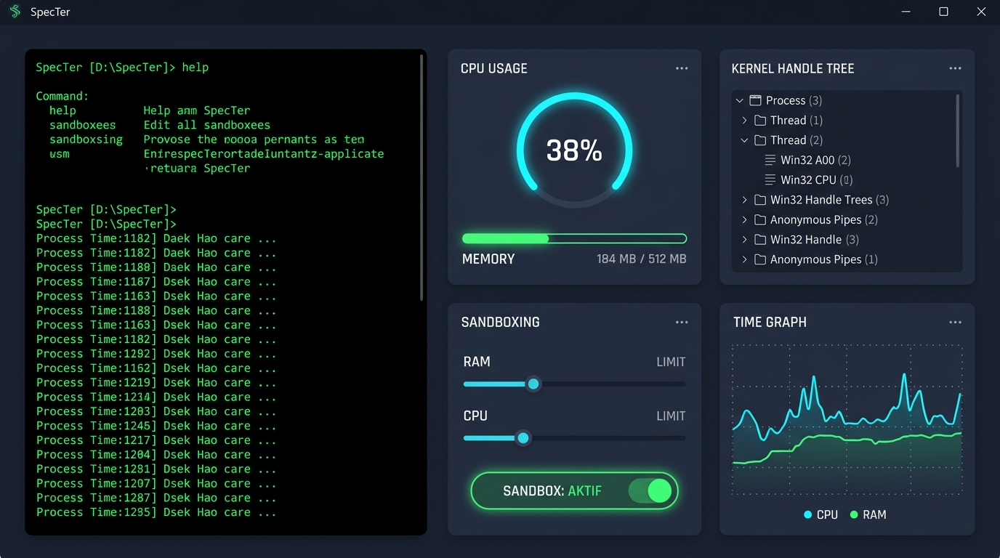

# SpecTer (Observability & Sandboxed CLI/GUI Terminal)

Windows İşletim Sistemi kernel seviyesinde süreç yönetimi, canlı metrik izleme, sandboxing (güvenlik kısıtlaması) ve profesyonel grafiksel görselleştirme paneline sahip modüler C++ uygulaması. 



---

## 🚀 Proje Mimarisi ve Ekip Sorumlulukları

Proje 4 bağımsız ama birbiriyle entegre çalışan modülden oluşmaktadır:

| Modül | Sorumlu Üye | Görevi / İşlevi |
| :--- | :--- | :--- |
| **`ShellCore`** | **1. Üye** | REPL döngüsü, komut ayrıştırma (tokenizer), dahili (`cd`, `cls`, `dir`, `sysinfo`, `ps`, `kill`, `help`, `exit`) ve harici (`CreateProcessA`) süreç yönetimi, Win32 Anonymous Pipe ile STDOUT/STDERR yakalama ve canlı akış (streaming). |
| **`JobManager`** | **2. Üye** | Windows `Job Objects` API (`CreateJobObject`, `AssignProcessToJobObject`, `SetInformationJobObject`) ile süreçlere RAM ve CPU sınırları uygulama. |
| **`Profiler`** | **3. Üye** | `GetProcessMemoryInfo`, `GetProcessTimes` ve Toolhelp32 API ile anlık CPU/RAM kullanımı, iş parçacığı ve kilitli Handle analiz raporu üretimi. |
| **`UIEngine`** | **4. Üye** | Profesyonel Grafiksel Arayüz (GUI Dashboard): Sol panelde Cyberpunk tarzı gömülü terminal konsolu, sağ panelde canlı RAM/CPU dairesel göstergeleri, 60 saniyelik zaman serisi grafikleri, interaktif Sandbox slider denetimleri ve Kernel Handle hiyerarşi ağacı. |

---

## 🛠 Derleme ve Çalıştırma (Build & Run)

### Gereksinimler
- **Windows OS** (Native Win32 API)
- **C++17 Uyumlu Derleyici** (MSVC / MinGW-w64 / Clang)
- **CMake 3.16+**

### CMake İle Derleme
```powershell
# 1. Proje kök dizininde build klasörü oluşturun ve yapılandırın
cmake -B build -S .

# 2. Uygulamayı derleyin
cmake --build build --config Release

# 3. Çalıştırın
.\build\Release\SpecTer.exe  # MSVC
# veya
.\build\SpecTer.exe          # MinGW
```

---

## 📁 Proje Dosya Yapısı

```
SpecTer/
├── CMakeLists.txt         # Proje derleme ve kütüphane bağlantı kuralları (SpecTer.exe)
├── .gitignore             # Derleme çıktıları ve geçici dosyalar
├── README.md              # Proje dökümantasyonu ve mimari açıklama
└── src/
    ├── main.cpp           # Uygulama giriş noktası (WinMain) & 4 modül entegrasyonu
    ├── ShellCore.h        # 1. Üye: ShellCore sınıf tanımı & ProcessInfo struct
    ├── ShellCore.cpp      # 1. Üye: REPL, Tokenizer, Win32 Pipe & CreateProcessA
    ├── JobManager.h       # 2. Üye: Job Objects & Sandboxing sınıfı
    ├── JobManager.cpp     # 2. Üye: RAM/CPU limitleri uygulama implementasyonu
    ├── Profiler.h         # 3. Üye: Metrik İzleme & Handle Scanner
    ├── Profiler.cpp       # 3. Üye: Canlı CPU/RAM ve Toolhelp32 anlık örnekleme
    ├── UIEngine.h         # 4. Üye: Split-Screen GUI Paneli ve Gömülü Terminal
    └── UIEngine.cpp       # 4. Üye: Win32 GDI çizimi, Custom Controls & Dashboard
```

---

## 🤝 Ekip İçi Entegrasyon ve Çalışma Kuralları
1. Her üye kendi header ve kaynak dosyasında (`ShellCore`, `JobManager`, `Profiler`, `UIEngine`) geliştirmesini modüler olarak sürdürür.
2. `ShellCore` tarafından üretilen `ProcessInfo` yapısı (`hProcess`, `dwProcessId`) diğer modüller için ana veri kaynağıdır.
3. Süreçler `CREATE_SUSPENDED` bayrağı ile askıda başlatılır; `JobManager` kısıtlamaları uyguladıktan sonra `ResumeThread` ile güvenli şekilde çalışmaya devam eder.
