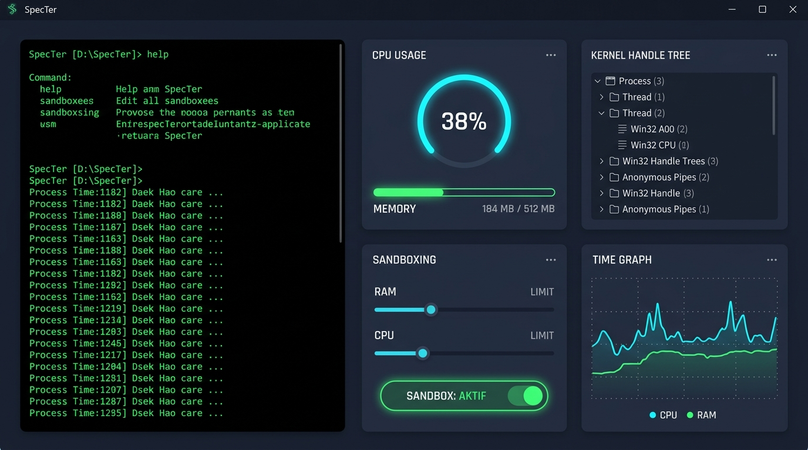

# SpecTer (Observability & Sandboxed CLI/GUI Terminal)

Windows İşletim Sistemi kernel seviyesinde süreç yönetimi, canlı metrik izleme, sandboxing (güvenlik kısıtlaması) ve profesyonel grafiksel görselleştirme paneline sahip modüler C++ uygulaması. 



---

## 🚀 Proje Mimarisi ve Ekip Sorumlulukları

Proje 4 bağımsız ama birbiriyle entegre çalışan modülden oluşmaktadır:

| Modül | Sorumlu Üye | Görevi / İşlevi |
| :--- | :--- | :--- |
| **`ShellCore`** | **1. Üye** | REPL döngüsü, komut ayrıştırma (tokenizer), dahili (`cd`, `cls`, `dir`, `sysinfo`, `ps`, `kill`, `report/export`, `help`, `exit`) ve harici (`CreateProcessA`) süreç yönetimi, Win32 Anonymous Pipe ile STDOUT/STDERR canlı akış (streaming) ve denetim loglama. |
| **`JobManager`** | **2. Üye** | Windows `Job Objects` API (`CreateJobObject`, `AssignProcessToJobObject`, `SetInformationJobObject`) ile süreçlere RAM ve CPU sınırları uygulama. |
| **`Profiler`** | **3. Üye** | `GetProcessMemoryInfo`, `GetProcessTimes` ve Toolhelp32 API ile anlık CPU/RAM kullanımı, iş parçacığı ve kilitli Handle analiz raporu üretimi. |
| **`UIEngine`** | **4. Üye** | Profesyonel Grafiksel Arayüz (GUI Dashboard): Sol panelde Tab-tamamlamalı Cyberpunk gömülü terminal, sağ panelde canlı RAM/CPU dairesel göstergeleri, limit aşım görsel uyarı animasyonu, 60 sn zaman serisi grafiği, interaktif Sandbox slider denetimleri, Kernel Handle ağacı, renk körlüğü temaları ve sabit oranlı tam ekran responsive ölçekleme. |

---

## ✨ Son Eklenen Yenilikler ve Gelişmiş Özellikler

### 1. ⚠️ Görsel Sandbox Limit Aşım Uyarısı (Gauge Alert & Flash)
* Sandbox modu aktifken çalışan alt süreç RAM veya CPU sınırına ulaştığında / aştığında arayüz anında alarma geçer:
  * **CPU Göstergesi:** Neon camgöbeğinden yanıp sönen uyarı kırmızısına (`P.accentDanger`) geçer ve altında `⚠️ CPU LİMİTİ AŞILDI!` uyarısı belirir.
  * **Bellek (RAM) Barı:** İlerleme çubuğu kırmızıya döner ve `⚠️ AŞILDI` etiketi görüntülenir.
  * **Sandboxing Kartı & Başlık Rozeti:** Kart çerçevesi kırmızı flaş yapar; sağ üstteki rozet `⚠️ LIMIT AŞIMI (DEVREDE)` şeklinde korumayı görselleştirir.
  * **Terminal Bildirimi:** Terminale anlık `[⚠️ GÜVENLİK UYARISI]` satırı basılır.

### 2. ⌨️ Akıllı Terminal Otomatik Tamamlama (Tab-Completion)
* Terminal giriş satırında **`TAB`** tuşuna basıldığında komutları ve alt parametreleri otomatik tamamlar:
  * **Komut Tamamlama:** `help`, `sandbox`, `sysinfo`, `tema`, `ps`, `kill`, `report`, `time`, `cls`, `dir` vb.
  * **Parametre Tamamlama:** `sandbox ` -> `on`, `off`, `status`, `set`, `ram`, `cpu`; `tema ` -> `normal`, `protan`, `deutan`, `tritan`.
  * **Dosya & Klasör Tamamlama:** Çalışma dizinindeki mevcut dosya ve alt klasörleri dinamik olarak listeler.
  * **Döngüsel Geçiş:** Birden fazla eşleşmede ardışık `TAB` basılarak alternatifler arasında hızlıca dolaşılabilir.

### 3. 📄 Oturum Denetim ve Sistem Raporu Dışa Aktarma (`report` / `export`)
* Terminalden `report` veya `export [dosya_adi.txt]` yazıldığında:
  * Sistem donanım özeti (OS, x64 mimarisi, CPU çekirdekleri, sayfa boyutu, fiziksel ve boş RAM miktarları),
  * Sandbox koruma modu ve aktif RAM/CPU limitleri,
  * Oturum boyunca yürütülen tüm komutların sıralı geçmişi (`history`),
  * Tarih-saat damgalı resmi denetim raporu olarak diske kaydedilir ve tam dosya yolu ekrana yazılır.

### 4. 🖥️ Sabit En-Boy Oranlı (1.75) Dinamik Boyutlandırma ve Tam Ekran
* **Pencere Boyutlandırma:** Standart `WS_OVERLAPPEDWINDOW` başlığı sayesinde pencere kenarlardan serbestçe boyutlandırılabilir veya tam ekran (Maximize) yapılabilir.
* **Oran Kilidi (`WM_SIZING`):** Yeniden boyutlandırma esnasında orijinal 1400:800 (7:4 / 1.75) en-boy oranı kilitlenir; arayüz asla basıklaşmaz.
* **Tam Ekranda Sıfır Bozulma (`updateLayout`):** 1080p, 2K veya 4K ekranlarda simetrik merkezlenmiş responsive viewport kullanılır. Sol terminal paneli, sağdaki 4 gösterge kartı, slider'lar, switch ve yazı tipleri orantılı olarak kusursuz ölçeklenir (`m_scale`).

### 5. 🎨 Renk Körlüğü Erişilebilirlik Temaları
* Farklı renk algılarına sahip kullanıcılar için 4 dahili tema:
  * **Normal (Cyberpunk):** Klasik neon yeşil & camgöbeği.
  * **Protanopia:** Kırmızı körlüğü için optimize edilmiş mavi/sarı ekseni.
  * **Deuteranopia:** Yeşil körlüğü için optimize edilmiş mavi/turuncu ekseni.
  * **Tritanopia:** Mavi körlüğü için optimize edilmiş kırmızı/camgöbeği ekseni.
* **Kısayollar:** `F2` veya `Ctrl+T` ile anında tema döngüsü; `tema` komutu ile INI dosyasına (`specter_themes.ini`) kaydetme/yükleme.

---

## ⌨️ Klavye Kısayolları ve Komut Referansı

| Kısayol / Komut | İşlev / Açıklama |
| :--- | :--- |
| **`TAB`** | Komut, parametre veya dosya adını otomatik tamamlar / eşleşenler arasında döner. |
| **`F2` / `Ctrl+T`** | Erişilebilirlik renk körlüğü temaları arasında anında geçiş yapar. |
| **`Ctrl+L`** | Terminal ekranını temizler (`cls` ile aynı). |
| **`Ctrl+C`** | Çalışmakta olan harici alt süreci sonlandırır (Interrupt/SIGINT). |
| **`Yukarı / Aşağı Ok`** | Daha önce yazılan komutlar arasında geçmişte (History) gezinir. |
| **`report` / `export`** | Sistem, sandbox ve oturum geçmişini içeren rapor dosyasını kaydeder. |
| **`stress [MB] [sn] [%]`** | Canlı telemetri grafiği ve sandbox limitlerini test etmek için stres işçisini başlatır. |
| **`tema [liste\|ad\|kaydet]`** | Erişilebilirlik temasını listeler, değiştirir veya yapılandırır. |
| **`sandbox on/off/set`** | Job Objects RAM ve CPU kısıtlamalarını yönetir. |

---

## 🛠 Derleme ve Çalıştırma (Build & Run)

### Gereksinimler
- **Windows OS** (Native Win32 API)
- **C++17 Uyumlu Derleyici** (MSVC / MinGW-w64 / Clang)
- **CMake 3.16+**

### CMake İle Derleme
```powershell
# 1. Proje kök dizininde build klasörü oluşturun ve yapılandırın
cmake -B build -S .

# 2. Uygulamayı derleyin
cmake --build build --config Release

# 3. Çalıştırın
.\build\Release\SpecTer.exe  # MSVC
# veya
.\build\SpecTer.exe          # MinGW

# 4. Otomasyon Testlerini Çalıştırın (38 Test / Uçtan Uca Doğrulama)
.\build\Release\SpecTer.exe --test
# veya CTest ile
ctest --test-dir build -C Release --output-on-failure
```

---

## 📁 Proje Dosya Yapısı

```
SpecTer/
├── CMakeLists.txt         # Proje derleme ve kütüphane bağlantı kuralları (SpecTer.exe)
├── .gitignore             # Derleme çıktıları ve geçici dosyalar
├── README.md              # Proje dökümantasyonu ve mimari açıklama
└── src/
    ├── main.cpp           # Uygulama giriş noktası (WinMain) & 4 modül entegrasyonu
    ├── ShellCore.h        # 1. Üye: ShellCore sınıf tanımı & ProcessInfo struct
    ├── ShellCore.cpp      # 1. Üye: REPL, Tokenizer, Win32 Pipe & CreateProcessA
    ├── JobManager.h       # 2. Üye: Job Objects & Sandboxing sınıfı
    ├── JobManager.cpp     # 2. Üye: RAM/CPU limitleri uygulama implementasyonu
    ├── Profiler.h         # 3. Üye: Metrik İzleme & Handle Scanner
    ├── Profiler.cpp       # 3. Üye: Canlı CPU/RAM ve Toolhelp32 anlık örnekleme
    ├── TestSuite.h        # Entegre Otomasyon Test Paketi Header
    ├── TestSuite.cpp      # 38 Kapsamlı Modüler Birim & Entegrasyon Testi
    ├── UIEngine.h         # 4. Üye: Split-Screen GUI Paneli ve Gömülü Terminal
    └── UIEngine.cpp       # 4. Üye: Win32 GDI çizimi, Custom Controls & Dashboard
```

---

## 🤝 Ekip İçi Entegrasyon ve Çalışma Kuralları
1. Her üye kendi header ve kaynak dosyasında (`ShellCore`, `JobManager`, `Profiler`, `UIEngine`) geliştirmesini modüler olarak sürdürür.
2. `ShellCore` tarafından üretilen `ProcessInfo` yapısı (`hProcess`, `dwProcessId`) diğer modüller için ana veri kaynağıdır.
3. Süreçler `CREATE_SUSPENDED` bayrağı ile askıda başlatılır; `JobManager` kısıtlamaları uyguladıktan sonra `ResumeThread` ile güvenli şekilde çalışmaya devam eder.
